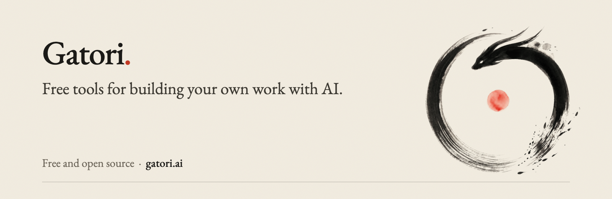
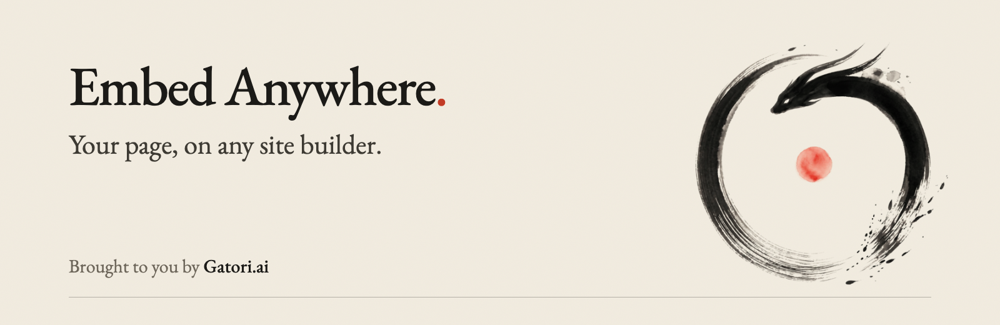
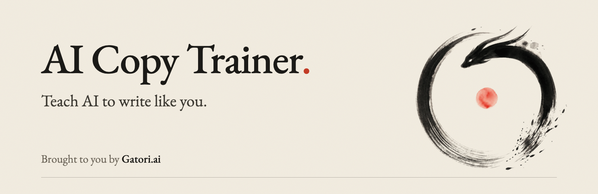
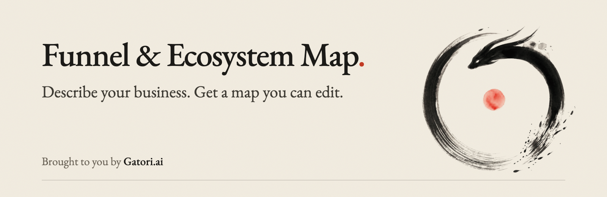

  <picture>
    <source media="(prefers-color-scheme: dark)" srcset="banner-night.png">
    
  </picture>

Each project is a folder you clone and run on your own computer, or hand to your AI agent. Your files stay with you. Every one is MIT licensed.

## Projects

<a href="https://github.com/Gatori-ai/embed-anywhere">
  <picture>
    <source media="(prefers-color-scheme: dark)" srcset="cards/embed-anywhere-night.png">
    
  </picture>
</a>

**[Embed Anywhere](https://github.com/Gatori-ai/embed-anywhere).** Your AI agent builds a page, or takes one you already have, hosts it, and puts it on Kajabi, GoHighLevel, Squarespace or any site builder. It checks the published page at phone, tablet and desktop widths and fixes what it finds. You never copy or paste code.

<a href="https://github.com/Gatori-ai/ai-copy-trainer">
  <picture>
    <source media="(prefers-color-scheme: dark)" srcset="cards/ai-copy-trainer-night.png">
    
  </picture>
</a>

**[AI Copy Trainer](https://github.com/Gatori-ai/ai-copy-trainer).** Reads your own writing, writes down the rules of how you sound, and sharpens those rules every time you edit a draft. One new draft a day, on a local page or inside your agent.

<a href="https://github.com/Gatori-ai/funnel-ecosystem-map">
  <picture>
    <source media="(prefers-color-scheme: dark)" srcset="cards/funnel-ecosystem-map-night.png">
    
  </picture>
</a>

**[Funnel & Ecosystem Map](https://github.com/Gatori-ai/funnel-ecosystem-map).** Describe a funnel or a whole business in plain words and get a map of it: content, offers, people, systems and the paths between them. Every card and arrow stays editable, by hand or by asking.

## Learn to build with it

[Gatori.ai](https://gatori.ai) is where Nathaniel Solace teaches people to build their own tools with AI.
